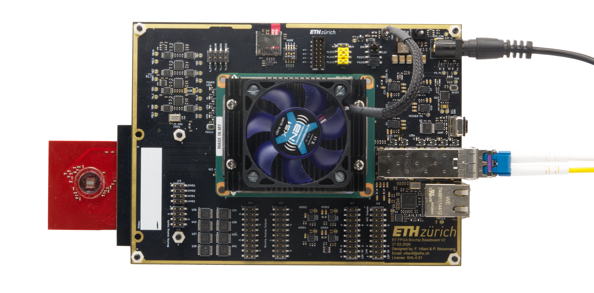

# MAGIE Hardware

Hardware of **MAGIE** (Multichannel Acquisition Gigabit Interface Engine), a retargetable FPGA-based acquisition platform developed at the Integrated Systems Laboratory (IIS), ETH Zurich.

This repository contains the KiCad sources and documentation of the MAGIE boards:

- the **baseboard**: an AMD Kria K26 carrier that connects high-density biosensor arrays to the FPGA fabric and streams their data over 10 Gbit/s SFP+ Ethernet;
- the **ultrasound boards**: a 64-channel ultrasound pulser frontend and two boards for testing it.


*MAGIE baseboard with the Kria K26 SOM and the fan-out board carrying the biochip.*

## Boards

| Board | Folder | Revision | Description |
|---|---|---|---|
| [Baseboard](hw/baseboard/) | `hw/baseboard/` | V2.1 | Kria K26 carrier with SFP+, 1 GbE, biochip supplies, 16 bias outputs and a 240-pin biosensor connector |
| [Pulser frontend](hw/pulser_frontend/) | `hw/pulser_frontend/` | 1.1 | 64-channel ±100 V ultrasound transmit frontend |
| [Frontend tester](hw/frontend_tester/) | `hw/frontend_tester/` | V1 | Adapter from the pulser frontend's PCIe x16 card edge to an FMC connector |
| [Pulser interface tester](hw/pulser_interface_tester/) | `hw/pulser_interface_tester/` | V1 | Break-out of the 64 pulser channels to headers and SMA connectors |

Each board folder is a self-contained KiCad project with its own README, which covers the board, its connectors, known errata and how to generate the manufacturing outputs.

## Repository layout

```text
.
├── hw/
│   ├── baseboard/                 # MAGIE baseboard (Kria K26 carrier)
│   ├── pulser_frontend/           # 64-channel ultrasound pulser frontend
│   ├── frontend_tester/           # frontend-to-FMC adapter
│   └── pulser_interface_tester/   # pulser channel break-out
├── LICENSES/                      # license texts
├── REUSE.toml                     # per-file license map
└── CITATION.cff                   # citation metadata
```

## Opening the designs

Open the `.kicad_pro` file in a board folder with **KiCad 10.0**. The schematics and PCBs contain embedded copies of all symbols and footprints, so you can view, check and fabricate the designs without extra libraries.

Some vendor 3D models are not redistributed. The boards that use them have a `3d_vendor/README.md` that explains where to get them.

## Safety

The pulser frontend and the pulser interface tester carry pulses up to ±100 V. Read the safety notes in their READMEs before you power them.

## Contributors
- Federico Villani: baseboard V2 design, ultrasound boards design, review and project supervision
- Pascal Wesemann: original baseboard design (V1) (available at https://gitlab.ethz.ch/ltl/theses/biochip/biochip_pcb)
- Tim Frey: MAGIE platform integration and validation (not included in this repository)

Supervision: Federico Villani, Dr. Hangxing Liu,  Prof. Dr. Luca Benini (Integrated Systems Laboratory, ETH Zurich).

## Citation

If you use this hardware, please cite it using **TODO ADD AFTER ARXIV SUBMISSION**

## License

| Content | License |
|---|---|
| Hardware design files (`*.kicad_*`, jobsets, `hw/baseboard/production/`) | [Solderpad Hardware License v0.51](LICENSES/SHL-0.51.txt) (`SHL-0.51`) |
| Documentation and images (`*.md`, `hw/baseboard/assets/`) | [Creative Commons Attribution 4.0](LICENSES/CC-BY-4.0.txt) (`CC-BY-4.0`) |

The per-file mapping is in [`REUSE.toml`](REUSE.toml).
